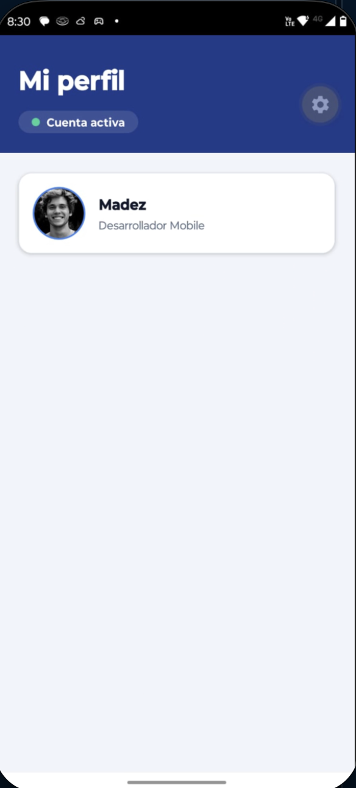

# TaskFlow

Aplicación mobile de gestión de tareas desarrollada con React Native, Expo (Managed Workflow) y TypeScript.

## Checkpoints

- **Checkpoint 1 – Estructura base:** inicialización del proyecto con Expo, TypeScript y herramientas de calidad de código.
- **Checkpoint 2 – Componentes y estilos:** arquitectura de carpetas en `src/`, pantallas `HomeScreen` y `ProfileScreen`, componente reutilizable `ProfileCard` y constantes de diseño centralizadas.
- **Checkpoint 3 – Formulario de tareas:** pantalla `AddTaskScreen` para crear tareas, con inputs controlados, validaciones, manejo del teclado y envío simulado.

## Estructura del proyecto

```
taskflow-app/
├── App.tsx               # Punto de entrada: monta el navegador de la app
├── index.ts
├── app.json              # Configuración de Expo
├── tsconfig.json         # Configuración de TypeScript
├── assets/               # Íconos y splash de Expo
└── src/
    ├── assets/           # Imágenes y fuentes locales
    │   ├── fonts/
    │   └── images/
    ├── components/           # Componentes reutilizables de UI
    │   ├── ActionButton.tsx
    │   ├── CategorySelector.tsx
    │   ├── EmptyState.tsx
    │   ├── FormField.tsx
    │   ├── ProfileCard.tsx
    │   ├── ScreenHeader.tsx
    │   ├── ScreenLayout.tsx
    │   ├── StatusBadge.tsx
    │   └── TaskListItem.tsx
    ├── constants/            # Constantes de diseño y de dominio
    │   ├── colors.ts         # Paleta de colores
    │   ├── taskCategories.ts # Etiquetas de categoría y categoría por defecto
    │   └── theme.ts          # Espaciados, tamaños de fuente, radios y sombras
    ├── context/              # Estado compartido entre pantallas
    │   └── TasksContext.tsx  # Lista de tareas en memoria y hook useTasks
    ├── hooks/                # Hooks personalizados
    │   └── useTaskForm.ts    # Estado, errores y envío del formulario de tareas
    ├── navigation/           # Configuración de navegación
    │   └── AppNavigator.tsx
    ├── screens/              # Pantallas principales
    │   ├── AddTaskScreen.tsx
    │   ├── HomeScreen.tsx
    │   └── ProfileScreen.tsx
    ├── services/             # Fuente de datos de usuario (hoy en memoria, a futuro un backend)
    │   └── userService.ts
    ├── types/                # Tipos compartidos del dominio
    │   ├── task.ts
    │   └── user.ts
    └── utils/                # Funciones puras
        ├── formatDate.ts     # Formato de fechas en español
        └── taskValidation.ts # Validación del formulario de tareas
```

## Navegación

La app usa un navegador de tabs inferior (`@react-navigation/bottom-tabs`)
definido en `src/navigation/AppNavigator.tsx`, montado desde `App.tsx` dentro
de `NavigationContainer`. Tiene tres tabs:

- **Tareas** (`HomeScreen`)
- **Nueva tarea** (`AddTaskScreen`)
- **Perfil** (`ProfileScreen`)

Cada pantalla dibuja su propio encabezado con `ScreenLayout`, así que el
encabezado nativo del navegador está deshabilitado (`headerShown: false`).

## Formulario de nueva tarea

`AddTaskScreen` permite cargar una tarea con título, descripción y categoría.
El estado vive en el hook `useTaskForm` (`src/hooks/useTaskForm.ts`).

- **Inputs controlados:** cada campo recibe `value` y `onChangeText`.
- **Validaciones** (`src/utils/taskValidation.ts`): el título es obligatorio y
  debe tener al menos 5 caracteres; la descripción es obligatoria y debe tener
  al menos 10. Los espacios al inicio y al final no cuentan. La categoría viene
  seleccionada por defecto en Personal.
- **Errores:** se muestran debajo del campo al salir de él o al intentar
  guardar, y el borde se pone rojo. Mientras haya errores visibles, el botón
  "Guardar tarea" queda deshabilitado.
- **Guardado:** si los datos son válidos, la tarea se agrega a una lista
  compartida en memoria (`TasksContext`) con su `id`, `createdAt` y
  `completed: false`, y se abre un `Alert` con dos opciones: "Crear otra"
  limpia el formulario y "Ver tareas" lo limpia y lleva a la tab **Tareas**.
  Mientras el aviso está abierto el botón queda deshabilitado para evitar
  guardar la misma tarea dos veces.
- **Teclado:** `ScreenLayout` usa `KeyboardAvoidingView` para que el teclado no
  tape los campos, y la tecla "siguiente" del título pasa el foco a la descripción.

Cada tarea guardada tiene esta forma:

```ts
{
  id: 'lq3k9x2a-4fj7ab',
  title: 'Preparar la presentación',
  description: 'Armar las diapositivas del sprint',
  category: 'work',
  createdAt: new Date(),
  completed: false,
}
```

### Cómo probarlo

1. Abrir la tab **Nueva tarea** y tocar "Guardar tarea" sin completar nada: aparecen
   los errores debajo de cada campo y el botón se deshabilita.
2. Escribir un título de menos de 5 caracteres y pasar a la descripción: el error
   del título se actualiza al salir del campo.
3. Completar los datos correctamente: el botón se habilita, al guardar aparece el
   aviso "Éxito" con las opciones "Crear otra" y "Ver tareas".
4. Tocar "Crear otra": el formulario vuelve a su estado inicial. Con "Ver tareas"
   también se limpia y se pasa a la tab **Tareas**.

## Componentes compartidos

`ScreenLayout` y `ScreenHeader` (en `src/components/`) concentran la estructura
común de pantalla: `SafeAreaView`, encabezado con título/subtítulo y el
`ScrollView` de contenido, envuelto en un `KeyboardAvoidingView` para que los
formularios no queden tapados por el teclado. Los tokens de diseño (colores,
espaciados, tamaños de fuente, radios y sombras) viven en `src/constants/`.

`ScreenLayout` acepta además la prop opcional `scrollable` (por defecto `true`).
Con `scrollable={false}` el contenido se renderiza sin `ScrollView` y sin padding,
para que una `FlatList` maneje su propio scroll sin anidar listas virtualizadas.

## Componente `ActionButton`

Botón de acción reutilizable con tres variantes.

| Prop                | Tipo                                   | Descripción                                |
| ------------------- | -------------------------------------- | ------------------------------------------ |
| `label`             | `string`                               | Texto del botón                            |
| `onPress`           | `() => void`                           | Se llama al tocar el botón                 |
| `variant`           | `'primary' \| 'secondary' \| 'danger'` | Estilo del botón (por defecto `primary`)   |
| `icon`              | nombre de `Ionicons` (opcional)        | Ícono a la izquierda del texto             |
| `disabled`          | `boolean` (opcional)                   | Deshabilita el botón y lo muestra atenuado |
| `accessibilityHint` | `string` (opcional)                    | Pista para lectores de pantalla            |

## Componente `EmptyState`

Mensaje para cuando no hay contenido que mostrar, con un llamado a la acción opcional.

| Prop      | Tipo                                     | Descripción                             |
| --------- | ---------------------------------------- | --------------------------------------- |
| `title`   | `string`                                 | Título del estado vacío                 |
| `message` | `string`                                 | Texto de apoyo                          |
| `icon`    | nombre de `Ionicons` (opcional)          | Ícono dentro del círculo superior       |
| `action`  | `{ label: string; onPress: () => void }` | Si se indica, muestra un botón primario |

`HomeScreen` lo muestra cuando no hay tareas, con un botón que lleva a **Nueva tarea**.

## Componente `TaskListItem`

Fila de la lista de tareas: casilla para marcarla como completada, título
(tachado si está completada) y una línea con la categoría y la fecha. Está
memoizado con `memo` para que la `FlatList` no vuelva a renderizar filas sin cambios.

| Prop                | Tipo                   | Descripción                              |
| ------------------- | ---------------------- | ---------------------------------------- |
| `task`              | `Task`                 | Tarea a mostrar                          |
| `onToggleCompleted` | `(id: string) => void` | Se llama con el `id` al tocar la casilla |

## Componente `FormField`

Campo de formulario reutilizable: etiqueta, `TextInput` y mensaje de error.
Acepta además todas las props de `TextInput`.

| Prop    | Tipo                | Descripción                                         |
| ------- | ------------------- | --------------------------------------------------- |
| `label` | `string`            | Texto de la etiqueta                                |
| `error` | `string` (opcional) | Mensaje de error; si existe, el borde se pone rojo  |
| `ref`   | `Ref<TextInput>`    | Referencia al input, por ejemplo para mover el foco |

El borde cambia a color primario cuando el campo tiene el foco.

## Componente `CategorySelector`

Selector de categoría con opciones en formato de chips, tomadas de `src/constants/taskCategories.ts`.

| Prop       | Tipo                               | Descripción                       |
| ---------- | ---------------------------------- | --------------------------------- |
| `value`    | `TaskCategory`                     | Categoría seleccionada            |
| `onChange` | `(category: TaskCategory) => void` | Se llama al elegir otra categoría |

## Componente `ProfileCard`

Tarjeta de perfil reutilizable. No contiene datos internos: todo lo recibe por
props, derivadas del tipo compartido `User` (`src/types/user.ts`).

| Prop    | Tipo     | Descripción                |
| ------- | -------- | -------------------------- |
| `name`  | `string` | Nombre del usuario         |
| `role`  | `string` | Rol o puesto               |
| `image` | `string` | URL de la imagen de perfil |

```tsx
<ProfileCard name="Madez" role="Desarrollador Mobile" image="https://i.pravatar.cc/300?img=12" />
```

- `ProfileScreen` la usa con los datos del usuario actual.
- `ProfileScreen` la reutiliza con distintos datos para listar al equipo.

Los estilos se definen con `StyleSheet.create` y toman colores y espaciados de `src/constants/`.

## Ejecución en Expo Go

`ProfileScreen` corriendo en un dispositivo Android con Expo Go:



## Requisitos

- Node.js (LTS)
- App Expo Go en el celular, o un emulador Android / simulador iOS

## Ejecución local

```bash
git clone <url-del-repositorio>
cd taskflow-app
npm install
npx expo start
```

Luego escanear el código QR con Expo Go, o presionar `a` (Android) / `i` (iOS) en la terminal para abrir el emulador.

## Scripts disponibles

| Comando                | Descripción                                       |
| ---------------------- | ------------------------------------------------- |
| `npm start`            | Inicia el servidor de desarrollo de Expo          |
| `npm run lint`         | Analiza el código con ESLint                      |
| `npm run lint:fix`     | Corrige automáticamente los problemas de ESLint   |
| `npm run format`       | Formatea el código con Prettier                   |
| `npm run format:check` | Verifica el formato sin modificar archivos        |
| `npm run typecheck`    | Verifica los tipos de TypeScript                  |
| `npm run validate`     | Ejecuta typecheck, lint y verificación de formato |

## Buenas prácticas y calidad de código

- **TypeScript** en modo estricto.
- **ESLint** con la configuración oficial de Expo (`eslint-config-expo`).
- **Prettier** para mantener un formato de código uniforme.
- **EditorConfig** para unificar la configuración del editor.
- **Husky + lint-staged**: antes de cada commit se ejecutan ESLint y Prettier sobre los archivos modificados.

## Próximos pasos

- Estado global con Redux
- Persistencia de las tareas en Firebase
- Adjuntar imágenes a las tareas
- Datos del usuario desde Firebase / Firestore
